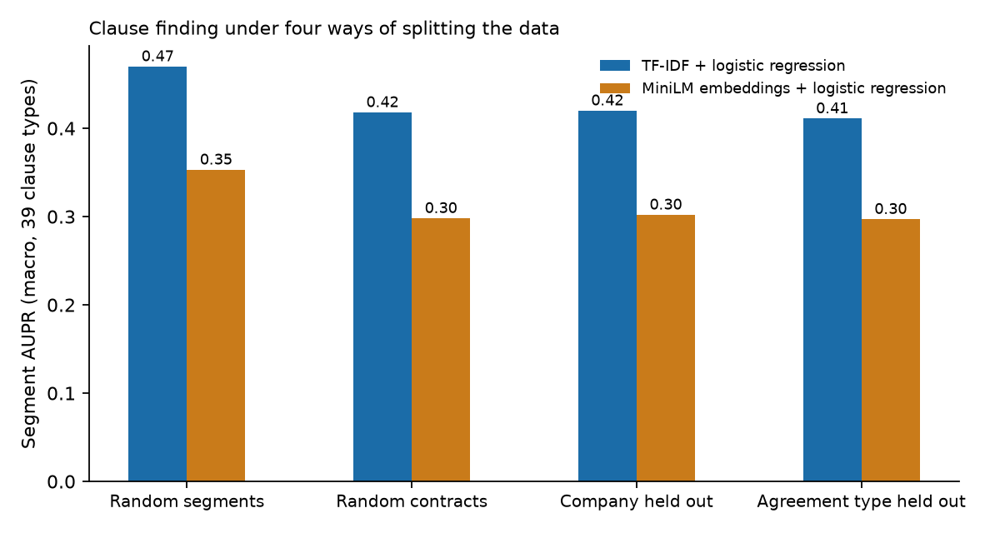
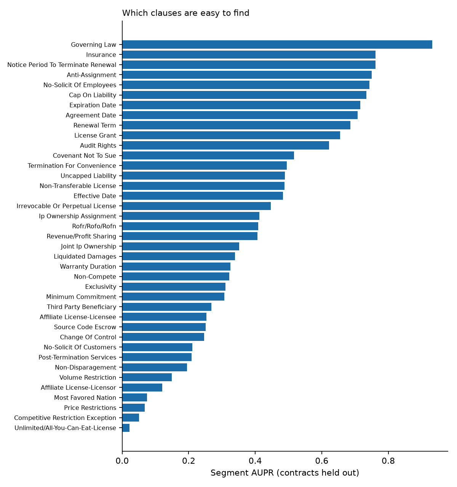
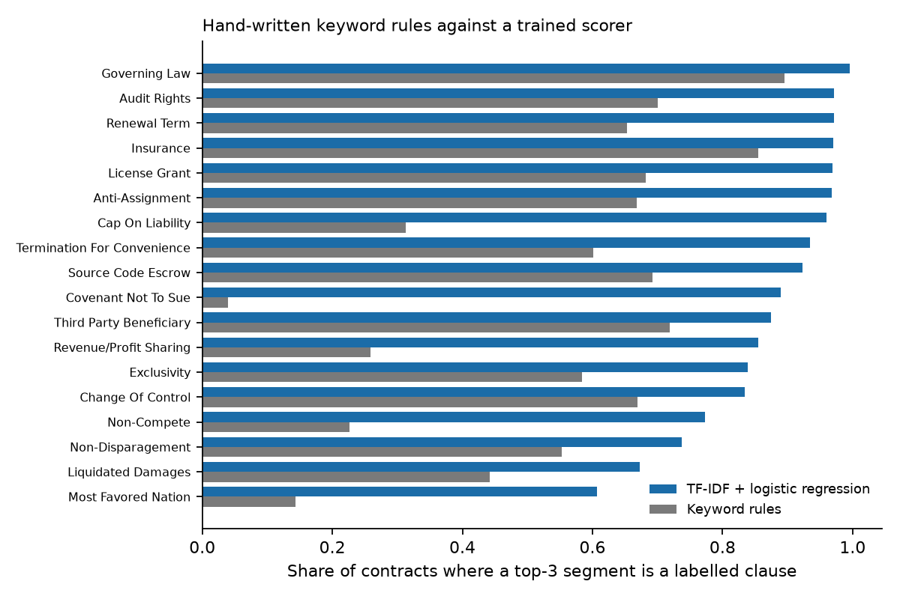

# Finding contract clauses with simple methods: how much do the scores depend on how you split the data?

Commercial contracts are long, and the clauses a lawyer cares about (who can assign the agreement, how liability is capped, whether there is a non-compete) are buried in tens of thousands of characters. The Contract Understanding Atticus Dataset (CUAD) has 510 real contracts in which legal experts marked 41 types of clauses. I wanted to know two things:

1. How far do simple, inspectable methods get at finding those clauses?
2. If the test data is chosen carelessly (for example, random sentences instead of whole contracts), how much does the score flatter the method?

## Short answers

All numbers are macro-averages over 39 clause types, out-of-fold, five folds. Segment AUPR is the area under the precision-recall curve over about 107,000 sentence-sized segments, where a random ranker scores about 0.003.

| Split used for testing | TF-IDF + logistic regression | MiniLM embeddings + logistic regression |
|---|---|---|
| Random segments (leaky) | 0.470 | 0.353 |
| Random contracts | 0.418 | 0.298 |
| Contracts from held-out companies | 0.420 | 0.302 |
| Contracts of held-out agreement types | 0.411 | 0.297 |

- **Splitting by segment inflates the score.** Mixing segments of the same contract between training and test adds about 0.05 AUPR (a gain in 35 of 39 clause types). Boilerplate and contract-specific wording leak across the split.
- **Holding out companies or agreement types costs almost nothing extra** once whole contracts are held out (differences of -0.002 and +0.007). In this dataset the leak is within a contract, not across related contracts.
- **A plain TF-IDF model beats frozen sentence embeddings** by about 0.12 AUPR. Clause detection here depends on specific legal wording, not on general meaning.
- **Hand-written keyword rules are far weaker than a trained scorer.** On the 18 clause types where I wrote a rule, the rules reach 0.162 AUPR against 0.476 for TF-IDF, and put a labelled clause in the top three segments for 54% of contracts against 88%.
- **Clause types differ enormously.** Governing Law (0.93 AUPR), Notice Period To Terminate Renewal, Anti-Assignment, Insurance and Cap On Liability are easy. Unlimited/All-You-Can-Eat License (0.01), Competitive Restriction Exception, Price Restrictions, Volume Restriction and Most Favored Nation (0.10) are close to unsolved for these methods.





## What I looked at in the data first

See [outputs/audit.md](outputs/audit.md). In brief: 510 contracts from 463 companies and 158 agreement types; 13,823 labelled spans, all aligned exactly with the contract text; median contract length 33,143 characters; the same sentence is labelled with several clause types 1,210 times; 1,176 sentence texts are repeated across contracts (3% of segments).

## Method in one paragraph

Each contract is cut into sentence-like segments (median 197 characters). A segment is positive for a clause type if it lies mostly inside a span the experts marked, or holds most of a short span. For every clause type I train a one-vs-rest logistic regression and score every held-out segment. Contract-level presence uses the highest segment score. "Hit at 3" is the share of contracts that have the clause where one of the three top-ranked segments is positive. Details and limits are in [METHODS.md](METHODS.md).

## Limits

These numbers are not comparable to the CUAD paper's, which frames the task as span extraction with a different match rule and uses fine-tuned transformers. I did not fine-tune a transformer or use a large language model. I used one random seed, a segmentation I wrote myself, and 12:1 negative subsampling for training. The keyword rules are my own and are a single reasonable attempt, not a ceiling for rule-based methods. Document Name and Parties are left out because they are not clause-finding tasks.

## Reproduce

```
pip install -r requirements.txt
python -I src/run_all.py
```

Data comes from the Zenodo record for CUAD v1 (https://zenodo.org/records/4595826, CC BY 4.0). `src/00_download.py` fetches it. Expect about 25 minutes on a 16-core CPU, most of it embedding the segments.

## Layout

- `src/` numbered scripts, `sql/audit.sql` exploratory queries, `outputs/` result tables and audit, `docs/img/` charts.

## Data and license

Code is MIT. CUAD is by The Atticus Project, released under CC BY 4.0; cite Hendrycks, Burns, Chen and Ball, "CUAD: An Expert-Annotated NLP Dataset for Legal Contract Review" (2021).
